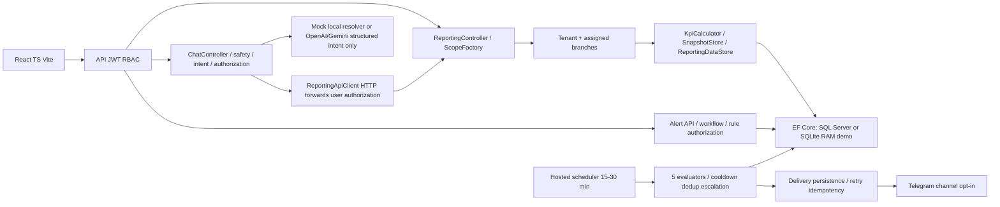

# Kiến trúc hệ thống đang bàn giao
## Luồng dữ liệu

Hosco.Domain chứa entity/enum; Application chứa contracts/catalog/guards/calculator; Infrastructure chứa EF/persistence/export/notification; Api composition root/HTTP/JWT; Web giao diện. Tests tách Unit, real Kestrel Integration và Node Web regression.
## Ranh giới quyền và AI
JWT được kiểm chữ ký, issuer/audience/lifetime; roles và branch claims do IdentityStore cấp. UI không phải authorization boundary. ReportingScopeFactory và BranchScopeValidator chống đổi tenant/branch trong request. Admin demo không là superuser xuyên tenant.
Chat không trực tiếp truy cập DbContext. Safety guard chạy trước provider; structured intent bị validate/allowlist rồi scope reauthorize; Reporting API tiếp tục kiểm JWT/scope độc lập. LLM không tính KPI, không có SQL tools và không thể chọn URL tùy ý.
Mock không tạo số liệu KPI: câu trả lời lấy real scoped API. Missing key/model hoặc provider failure dùng deterministic fallback; timeout/retry bounded. Live behavior chưa được chứng nhận.
## Database và vận hành
SQL Server startup MigrateAsync; SQLite startup EnsureCreated và RAM giữ bởi keep-alive connection. Seed khi bật có thể cập nhật final fixtures, không dùng production. Alert scheduler chạy riêng theo cấu hình; real Telegram mặc định disabled trong runner.
PDFsharp6.2.2/NotoSans embedded tạo PDF Unicode nhiều trang; XLSX OOXML typed cells/width/wrap. Crypto Pkcs/Xml10.0.13 là targeted patch; shared runtime vẫn cần IT xác nhận.
Ownership: DEV giữ kiến trúc kỹ thuật; BA chốt semantics; mentor phê duyệt deployment/privacy. [ADR](ADR_INDEX.md), [runbook](OPERATIONS_RUNBOOK.md).
