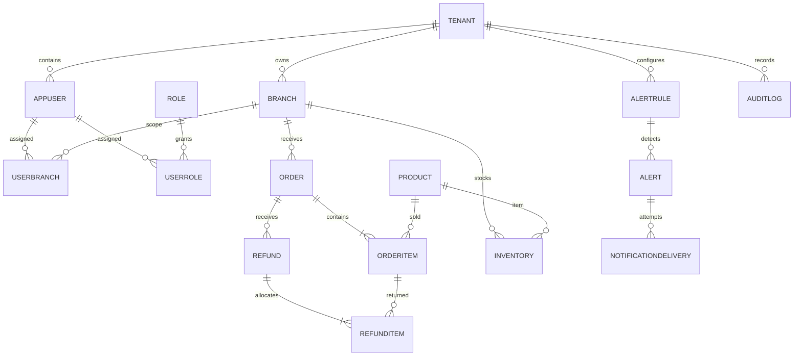

# Tài liệu dữ liệu GD6
## Nguồn và phiên bản
Source model và migrations là technical schema; KPI workbook GD1/SRS là business reference. [Data Dictionary GD2](../gd2/DATA_DICTIONARY.md), [Query Catalog](../gd2/QUERY_CATALOG.md), [Semantic code](../../src/Hosco.Application/Semantics/SemanticCatalog.cs), [BA decisions](../testing/BA_DECISIONS.md). Không tuyên bố các diễn giải source đã được BA phê duyệt.
## ERD bổ sung

Phần customer/employee/payment và chi tiết cột ở [ERD GD2](../gd2/ERD.md). Không suy diễn mọi TenantId FK đều tự áp row-level security; stores vẫn phải predicate Tenant/Branch.
| Aggregate | Cột quan trọng / invariant |
|---|---|
| Organization/identity | TenantId, UserRole, UserBranch; 4 actual role, PBKDF2 password hash |
| Order/OrderItem | OrderedAt, status, quantity, UnitCostAtSale; giá vốn lịch sử, không thay bằng current cost |
| RefundItem | RefundId + OrderItemId unique theo tenant; quantity và returned value hỗ trợ allocation |
| Inventory/Product | OnHand-Reserved; SafetyStock, IsKeySku, FloorPrice; current stock, không historical snapshot |
| AlertRule | unique Tenant+Branch+Code; typed ConfigJson, enabled, severity/window/cooldown |
| Alert | RuleId, TenantId, BranchId, dedup key, observed/baseline/threshold, workflow actors/time/note |
| NotificationDelivery | AlertId, channel, recipient key, purpose, attempt status, next retry time, idempotency key |
| AuditLog | action, user/scope, query/correlation ID; không persist secret/raw provider errors |
## KPI đang áp dụng
Revenue=recognized sale value minus discounts/allocated returns; GMV=unit sale price×valid quantity trước discounts; Orders=distinct recognized sales theo current source; AOV=Revenue/Orders (zero denominator null); GP=Revenue−valid-quantity historical COGS; Margin=GP/Revenue×100 (Revenue0 null); cancel/return rate=distinct affected/all created order cohort; Top/Bottom=valid quantity, stable ties; dangerous=current available<=safety.
UTC+7, API inclusive instants. UI áp ngày local00:00 đến23:59:59.999+07; fixtures không có sự kiện ở millisecond cuối nên không kết luận boundary precision tuyệt đối. API AOV1 decimal, Margin2; UI money0 decimal. Scope sản phẩm/nhân viên rộng trong SRS chưa có canonical endpoints tương ứng.
KPI03 eligibility93vs87, event date/rate denominator, snapshot stock, rounding, boundary/default/context và performance vẫn BA-GD5-01..10 PENDING.
## Migration/seed
4 migrations: InitialCreate; AddDashboardAlertFoundation; SyncFinalGd1BusinessRules; CompleteGd3NotificationDelivery. [Demo guide](DEMO_DATA_GUIDE.md) ghi generation và idempotence. Ngoài SQL script/list offline, GD6 đã áp đủ 4 migrations vào database SQL test riêng và kiểm startup/restart/KPI. Backup/restore vẫn chưa được thử. Seed branch configs có thể reset defaults/Unicode names; chỉ database test riêng.
